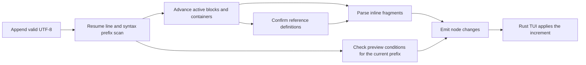

# Streaming Markdown parser architecture for Rust TUIs

## Goals and configuration

One AI response corresponds to one parser session. Each append produces a batch of updates carrying an ID, kind, typed data, and lifecycle state. A TUI selects a component by kind and uses the state to decide whether to preview, update, or finalize. Native Rust provides both complete parsing and append parsing over the same grammar rules. The core handles Markdown data only; line layout, syntax highlighting, and terminal escaping belong to the TUI.

Syntax and previews are independent options. The default syntax is GFM; pure CommonMark is available separately. AI preview is explicit and composes with either syntax. Math, custom blocks, and Markstream-specific rules are controlled by explicit extension flags. Syntax configuration and plugins are fixed before a session starts.

| Option | What it controls | TUI example |
| --- | --- | --- |
| `Syntax::Gfm` / `Syntax::CommonMark` | Block and inline grammar, and therefore the complete parse of a text. | GFM supports tables and task items. |
| `Preview::Off` / `Preview::Ai` | Whether enough prefix evidence exists to send a provisional kind or style to the UI early. | `Syntax::Gfm` + `Preview::Ai` provides both real GFM tables and previews of unfinished tables. |

For identical syntax, extensions, and content, `finish()` must match complete parsing, with previews on or off. When matching official examples, use the syntax and extensions that the example specifies. Whether a physical fence has arrived may be recorded separately as lifecycle state; the complete syntax tree still follows the specification. [CommonMark parsing strategy](https://spec.commonmark.org/0.31.2/#appendix-a-parsing-strategy) · [GFM specification](https://github.github.com/gfm/)

## Parsing pipeline



1. **Prescan** consumes new bytes from the previous cursor and identifies line endings, indentation, escapes, and possible syntax triggers. It records the current line and the progress of candidate delimiters. A trailing `\r` waits to see whether the next chunk starts with `\n`, forming CRLF. The network layer assembles complete UTF-8 characters before calling `append(&str)`. All positions count bytes in the original input.
2. **Block parsing** advances line by line with the active container stack. It first checks continuation conditions for parents such as lists and block quotes, then applies the block start, continuation, and end rules of the current syntax. It distinguishes lazy continuation, Setext underlines, GFM table delimiter rows, and fence closers. Confirmed body ranges go to the corresponding leaf block; leaves such as code and raw HTML use their own body rules. An unfinished line only advances the current checkpoint; later bytes commit structure when the conclusion becomes provable.
3. **Inline parsing** advances per active leaf block or table cell and tracks unresolved delimiters, backtick lengths, brackets, and reference candidates. Plain text appends spans, and local conclusions that change are corrected from the affected position. A block structure change can reinterpret its uncommitted leaf content. Cross-block references use a separate dependency index.
4. **Preview projection** reads the rule state at the current cursor and produces independent preview updates after an evidence threshold. Previews are published under the same block ID and can be withdrawn. Source, grammar stack, and reference index only receive real input bytes.
5. **Change emission** creates a parent node before writing its children or body. Consecutive text appends in the same batch are merged. The caller applies the changes and can consume the next batch.

## How previews are predicted

Previews use grammar evidence that has already arrived. A single trigger character only moves a rule into its candidate state. Each rule defines a trigger position, continuation conditions, the first condition that permits display, a confirmation condition, and a rejection condition. No preview is sent until escapes, container position, and the current active block have been checked. When evidence is insufficient, the existing display stays in place: the tail may continue to show ordinary text, or AI mode may briefly hold back an ambiguous marker.

| Rule | Waiting stage | Preview threshold | Confirmation or withdrawal |
| --- | --- | --- | --- |
| GFM table | Only the header row has arrived, or the next row so far contains only pipes and whitespace. | After a complete candidate header, the delimiter row has at least one actual hyphen, the bytes read so far can still form a valid delimiter row, and the column count does not exceed the header. A table preview may be emitted. | Confirmed when the delimiter row ends and matches the column count. Keep the paragraph when an unrecoverable character or column-count error appears. |
| Lists and block quotes | An isolated `-`, `>`, `2.`, or `1. *`. A number can still continue as ordinary text. | Project the container only after the marker, the boundary required by the grammar, and the first identifiable body text for that level have all arrived. | Formal block rules decide paragraph interruption, indentation, and continuation; EOF decides a legal empty list item or empty block quote. |
| Fenced code | Fewer opening backticks or tildes than required, or an incomplete info string. | Show a code block once the line-start position, indentation, container conditions, and complete opening fence line all satisfy the grammar; the language is read from the completed info string. | Confirming the opening fence enters `Open`. Only a confirmed closing fence line enters `Closed`. |
| Emphasis and inline code | Only `*`, `**`, or a backtick run. | Once delimiter context is satisfied and displayable content exists, the owning paragraph can receive a provisional style. | Confirmed when paired; an unmatched delimiter is restored as literal text at the paragraph boundary or EOF. |
| Links and images | An isolated `[`, `![`, or an unclosed label. | Once the label and the start of a destination structure are recognized, a label preview may be shown when a valid prefix exists. | Provide an interactive link or image only after syntax confirmation and an available destination; withdraw the preview when later content rejects it. |
| Math and custom blocks | An isolated `$`, `<`, an incomplete tag name, or an incomplete extension prefix. | Project only when the corresponding extension is enabled and its specific boundary and body threshold have been reached. Currency and comparison expressions stay literal. | Use the extension's own closing and fallback rules. Ordinary code, escapes, and already-confirmed syntax context still take precedence. |

For example, append `A | B\n`, `|`, `-`, and `| - |\n` one at a time. The first step is still a paragraph, the second only updates candidate scan state, the third may emit a provisional table, and the fourth confirms it. If `no` arrives after the third step, only the current block is updated and the text view returns. Candidate checks advance with new bytes, so a longer prefix never rescans the whole line.

Once a table is confirmed, a leading `|` on a new line is enough to recognize a table row. An empty provisional cell can be delivered at that point and updated when its body arrives.

The regression cases of `stream-markdown-parser` provide positive and negative examples for these rules. A single-line header must not start a table, an isolated list marker must not introduce a nested item, and an unclosed bold run must eventually fall back to text. The legacy table preview also stayed loading when the second row held only pipes or later a full-width colon. The new native AI rules require actual delimiter evidence; those prefixes are recorded as migration differences, and the legacy assertions and the new rule assertions are kept separately. Differential comparison checks observable behavior, and the difference report names each case and prefix. [Table regression](../test/original/table-loading-midstate.test.ts) · [Ordered-list regression](../test/behavior/ordered-list-streaming-jitter.test.ts) · [Unclosed-bold regression](../test/behavior/final-unclosed-strong-literal.test.ts)

## Nodes, states, and the Rust API

The first version persists only lifecycle, source range, and typed data on a node. The variants of `BlockData` are the node kinds. `BlockId` is the address in the update stream and can be used directly as a key in the TUI's node table. Node creation supplies the parent and insertion position; the consumer owns tree order. A paragraph that becomes a Setext heading keeps its ID; a split that creates a new block allocates a new ID.

```rust
struct Block {
    span: Span,
    status: BlockStatus,
    data: BlockData,
}

enum BlockStatus {
    Open,
    Closed,
    Incomplete,
}
```

| Kind | Minimum data for the UI |
| --- | --- |
| Paragraph, heading | Confirmed inline content. When the body is identical to the block range, reference that range directly; a heading also carries its level. |
| Code block | Info string and code body. The language is derived from the info string; `diff`, `mermaid`, and similar values go to specialized views. |
| List, block quote | Child blocks are represented by their position in the tree. A list additionally records the start number, tightness, and task state that affect display. |
| Table | Column alignment, header, and inline cells; changes address a row or the current cell. |
| HTML and registered custom tags | A custom tag exposes its tag name and attributes; its body follows the tag rules. Raw HTML in conformance mode keeps its source range. |
| Math, footnotes, and other extension nodes | The typed data the grammar actually requires. Extension nodes use the kind identifier and typed fields fixed at registration time. |

A fence's info string is read through `BlockData::code_info()`. A summary and a footnote share the source start of their owning block; `Block::summary_opening()` and `Block::footnote_label()` return the complete ranges.

### HTML/XML-style custom tags

Tags registered in `Options::custom_tags` can become `BlockData::CustomTag` or `InlineKind::CustomTag`. Both block and inline nodes expose the name and attributes to the TUI through `element.tag.tag_name(source)` and `element.tag.attrs(source)`. Tag metadata stores only the source ranges of the tag name and attribute region. Attribute iteration borrows the original text, preserving original spelling, entity references, and attribute order, and distinguishes a missing value (`None`) from an empty value (`Some("")`). The body is provided by its source range and parsed Markdown children.

For example, receive `<tool-call name="search" title="a >` followed by ` b">`. Prescan preserves the current quote state across chunks; a `>` inside a quoted value is part of the attribute. Once the `>` outside quotes arrives, the confirmed `tool-call` node and its attributes are emitted. A paired block-level tag is `Open` while its body arrives and becomes `Closed` after the matching end tag. The self-closing form `<tool-call name="search" />` is delivered as `Closed` immediately. If the opening tag is confirmed but the end tag is missing before EOF, the block becomes `Incomplete`. Provisional styles and updates for inline tags are managed by the owning block.

An opening tag for a top-level registered tag may span physical lines, and a quoted attribute value keeps its original newlines. If candidate detection fails or EOF arrives before completion, the buffered lines return to ordinary Markdown handling.

Within a registered tag body, `<!-- ... -->` and `<![CDATA[ ... ]]>` keep their source text. A same-name closing tag inside either construct does not end the body; scanning resumes from the current cursor after the closing marker arrives.

Registered tags use ASCII names and match case-sensitively. A colon in a name is preserved as a literal character. Raw HTML recognized by CommonMark/GFM is delivered through its source range. [XML start tags, end tags, and empty-element tags](https://www.w3.org/TR/xml/#sec-starttags)

With Markstream enabled, a standalone top-level `<div>` or `<section>` is first delivered as raw HTML. If a blank line arrives while the opening tag is still unclosed, the parser reuses the block ID and promotes it to `HtmlWrapper`. The body before the blank line is read back once and delivered as Markdown child blocks; later body content is parsed incrementally line by line.

### Three block states

| Persisted state | Behavior it must distinguish |
| --- | --- |
| `Open` | Appends can still change the block. Formal syntax such as a Setext underline can reclassify a block that is still open. |
| `Closed` | The block's local syntax structure has ended. Ordinary appends skip the block; a late reference can still update its content in place. |
| `Incomplete` | The session has ended and a required closing marker did not arrive. The TUI stops loading and can still distinguish a complete fence from a truncated one. |

### Finalization and malformed input

A parser session has exactly one final marker: `finish()`. Complete parsing (`parse()`) is final by definition. The API deliberately has no per-append `final` boolean because append boundaries do not change meaning: a session may receive the message in one chunk or in thousands, and `finish()` settles whatever the last append left open.

This is the Rust equivalent of `final: true` in `stream-markdown-parser`:

- `Parser::finish` / `BorrowedParser::finish` are the final mode for a streaming session. Call `finish()` after the last chunk even when that chunk appears to complete the message. An append on its own is always a streaming state.
- `parse()` is the final mode for a complete document and the right entry point for history messages.
- `finish()` is idempotent. A second call emits no changes, and an append after it returns `ParseError::Finished`.

Finalization is authoritative:

- Every provisional inline node (`InlineKind::CodePreview`, `InlineKind::LinkPreview`, `InlineKind::ImagePreview`) and every `Preview`/`PreviewInlines` overlay is withdrawn.
- Incomplete inline syntax is reparsed as literal source according to CommonMark/GFM. An unclosed link or image destination does not remain linked, and a closed `![...]` that cannot become an image stays text. A URL that GFM autolinking recognizes inside the resulting literal source may still become an ordinary `Link`.
- Unclosed block constructs become `Incomplete`; paragraphs whose grammar is complete become `Closed`.
- A final parse never reports a loading construct that can no longer resolve. The Rust API represents "loading" as a preview node or overlay, so `finish()` is the point after which no loading state remains.

| Final input | Final block content |
| --- | --- |
| `` | Text ``; no image. |
| `![a] (https://e.com/l)` | Text `![a] (`, autolink, text `)`; a space between `]` and `(` is never folded into link syntax. |
| `vec![1, 2, 3]` / `![alt]` | Literal text; a closed bracket that cannot become an image is not a placeholder. |
| `See []( http://s` | Text `See [`, the real `a.png` image, text `]( http://s`; the image stays visible instead of hiding behind an unfinished link. |
| `::: tip`<br>`<https://example.com>`<br>`:::` | An autolink whose label is the destination. |
| `)` | An image whose destination is delivered verbatim; scheme policy belongs to the renderer. |

**Security boundary.** The parser is not a sanitizer. Raw HTML is delivered as source ranges, and link and image destinations are delivered verbatim. A TUI must validate URL schemes and sanitize HTML before rendering or activating anything. The core does not reject `javascript:`, `data:`, or `file:` destinations because such filtering is a rendering policy rather than CommonMark/GFM syntax, and a parser-level filter would make `parse()` and `finish()` diverge from the specification.

The final-source shapes above, preview withdrawal, streaming/static parity, and idempotent completion are pinned in [`tests/finalization.rs`](../tests/finalization.rs). The cases mirror the recent `final: true` fixes in `stream-markdown-parser` for unclosed destinations, closed brackets that cannot become images, images inside unfinished links, and spaced brackets.

### Provisional previews

The "provisional" view visible to a TUI comes from independent preview updates. A preview carries a block ID, an overlay range, and a hinted kind or style; when a new anchor is needed, the parser first establishes an ordinary text view at that position and then publishes the preview under that ID. Confirmation or withdrawal reuses the ID. Node replacement, removal, or closure clears covered previews; other early withdrawals emit a clear operation. A candidate that is only waiting for internal evidence keeps scan progress and has no UI state yet.

`PreviewInlines` is an inline overlay, not a guarantee that every node inside it is provisional. Once a construct is confirmed while its block is still open, the overlay may contain confirmed nodes; the overlay is cleared when the block is replaced or closed, or when an empty node list is emitted. This keeps a single rendering path for open paragraphs and headings.

Table delimiter rows, reference previews, and math previews share one working state, allocated when the first of them is used.

| Streaming case | Minimum change required |
| --- | --- |
| Only `*` or the leading pipe of a table's second row has arrived | The parser stores unresolved rule state. The UI keeps the current text or shows the ordinary content received so far. |
| `**bold` or a table start meets its preview threshold | Emit a preview for the owning block's source range. Inline markers are managed by the block, avoiding a lifecycle object for every inline fragment. |
| A table is confirmed or a candidate is rejected | Replace the block under the same ID with its formal form, or clear the preview and keep the existing text. |
| Fence body is still arriving | Stay `Open` and publish body increments. Emit one `Closed` update after a legal closing fence. |
| EOF arrives while a fence is still open | Update the block to `Incomplete`. An ordinary paragraph that EOF can close naturally becomes `Closed`. Unmatched inline styles are restored according to the grammar. |
| A reference definition arrives at the end of the document | Update the already-`Closed` block in place, preserving its state and ID. Block removal is expressed by the update stream; transport cancellation or failure is recorded by the application. |

`finish()` consumes the last line, settles pending references and active blocks, and returns with every block `Closed` or `Incomplete` and every preview cleared. Repeated completion emits no new changes; appending afterwards returns the session-finished error.

Markstream's AI preview uses `InlineKind::CodePreview` for inline code that has content but is still waiting for its closing backticks. Completion delivers `InlineKind::Code`; an unmatched delimiter at finalization stays literal text. Paragraphs and provisional table rows share the same kinds, so a TUI can reuse one set of renderers and status styles.

### Source and incremental output

The first version has the following interface shape. The caller owns and reuses `out`; the parser appends operations to it.

```rust
fn append(&mut self, chunk: &str, out: &mut Vec<Change>) -> Result<(), ParseError>;
fn finish(&mut self, out: &mut Vec<Change>) -> Result<(), ParseError>;
fn source(&self, span: Span) -> &str;
fn parse<'src>(source: &'src str, options: &Options) -> Result<Document<'src>, ParseError>;
```

`Change` covers insert, update, replace, remove, and preview. Updates express appending a code body, adding a table row, changing local inline content, changing list tightness, or changing status, according to node kind. The TUI derives `loading`, `final`, and interactivity from block status, the presence of a preview, and available data. Content append and status update for one block may be sent independently; the body stays in place.

The session keeps one copy of the source. Contiguous text is expressed as a half-open range; container indentation and multi-line bodies can use several source fragments. New text is retained only when decoding entities or another operation genuinely produces different content. A TUI can store nodes and ranges and borrow the source on demand; if a final message must outlive the session, it can take ownership of the final source and nodes. The parser hands formal nodes to the caller and retains only active rules, unresolved dependencies, and their positions. Delivered data needs no second tree in the parser.

`Parser` owns the source and accepts individual chunks. A session whose TUI already manages the source can move its `String` into `SourceBuffer` and parse appended content directly through `BorrowedParser`. After each append, the caller passes the buffer and the visible UTF-8 byte end to the parser. The buffer only supports appends, and the session is bound to its identity and verifies that the visible end never moves backwards. Node ranges can be used directly to read `SourceBuffer::as_str()`. Both entry points share incremental state, plugin registration, and error rollback.

"Minimum representation" here means semantic fields. Actual byte size also depends on the largest enum variant, alignment, and allocation of child data. The first version records the size of `Block`, `Change`, a source range, and the heap allocation per scenario; these measurements decide later whether to narrow offsets, split large variants, or compress fields.

## Incremental state and block cache

| State | Minimum information retained from the first version | When it is recomputed |
| --- | --- | --- |
| Prescan cursor and active block | Current line byte position, container stack, delimiter progress, and the most recent confirmable boundary. | Process only new content and open ranges that are actually affected on each append. |
| Structurally confirmed block | Index block ID and source position only while an unresolved dependency exists. | Normal appends skip earlier source, block, and inline parsing. Locate by ID only when a change is known to be needed. |
| Reference definitions and waiters | Confirmed definitions plus an index from normalized labels to affected leaf blocks, headings, or cells. | After the first valid definition is confirmed, recompute only registered inline ranges. |
| Deletion, truncation, or configuration change | The caller destroys the old session and builds a new one. | Append is the hot path in the first version; editing increments are considered separately. |

A reference definition may span lines, and completing a title or later text can affect whether it holds. Wait for the block rule to confirm it, then notify waiters. A late definition can affect bracket binding and nesting, so reparse the smallest complete inline context rather than replacing a single link field. Extensions that affect display order, such as footnotes, register dependencies independently. The longest unresolved span depends on the grammar; the cache boundary is determined by grammar state.

AI previews for active paragraphs and headings cache only confirmed plain-text prefix ranges. Lexical probing resumes from the last safe whitespace boundary, while the original range is still used to decide inline delimiters and emit updates. When a character cannot be proven stable, later context is retained. The cache does not copy source or nodes. `Metrics` records bytes submitted to preview probing and lexical entry points separately.

Later work uses scan counts and allocation profiles to decide whether to introduce small-object inlining, range compression, SIMD scanning, or additional hot caches. The first version's cache focuses on resuming, skipping stable blocks, and locating real invalidation.

## Complete parsing

Complete parsing borrows an existing `&str` and runs the same block, inline, plugin, and finalization rules through the batch entry point. Block parsing collects all definitions, then parses each block's inline data once and builds the final `Document` directly. The complete path can preallocate known capacity and skip streaming previews, pending-reference notifications, and change recording. Comparison with a streamed final result checks structure, data, source ranges, and final status; block IDs are only compared within their own sessions.

Independent messages in chat history can be restored with `restore_history(messages, visible, options)`. The iterator delivers messages in the visible range first, then the remaining messages in original order. Each item carries its original message index, so a TUI can limit work per call with `by_ref().take(n)` and fill slots back in place. Reference definitions are not shared between messages. An oversized single message still goes through one `parse` call.

## Plugin architecture

The first version supports built-in extensions, static Rust registration, and runtime loading of third-party plugins. A registration describes ASCII trigger characters, block or inline scope, and the resulting node type. Built-in rules keep direct calls; third-party rules receive only candidates that the core has confirmed are available and whose trigger character matched.

| Rule phase | Input the plugin receives | Allowed result |
| --- | --- | --- |
| Probe | A bounded source fragment starting at the trigger character. | Reject, wait for more input, or accept. |
| Advance | A bounded source fragment starting at the previous unconsumed position. | Consume progress, wait for more input, or accept. |
| Finish | Remaining input when the document or parent container ends. | Accept, or return the candidate to ordinary Markdown. |

Block rules are probed on complete Markdown lines in registration order. Inline rules run over original text ranges supplied by the core; grammar boundaries such as escapes and code are decided by the core. A block rule that waits keeps its cursor and state; once it accepts, the core allocates a node ID and emits structure. If a block candidate that consumed part of its input later rejects, the core replays only that candidate's source and restores block boundaries exactly as ordinary Markdown. When a parent container ends, candidates finish before the next line is processed. Waiting indefinitely without progress inside the bounded window returns a plugin error.

Runtime plugins use a **WASM module plus a versioned host protocol**, integrated as an optional host layer; a pure Rust TUI can choose whether to package the runtime. The application registers local modules and rule descriptions. The host validates protocol version, trigger conditions, and node field types at load time. Module code can be reused, while parser state is isolated per session. After a candidate matches, one call carries the relevant fragment or increment, and finished rule state is reclaimed. Data crossing the boundary uses explicit integers, byte ranges, and typed fields; plugins never receive host memory pointers.

The host constrains readable ranges, instructions, linear memory, and output size for third-party plugins, exposing only what the parsing protocol requires. Invalid ranges, advancing without progress, execution failures, and limit violations are returned to the caller as plugin errors. On failure, changes from the current append are discarded and the session ends; the TUI may keep content it has already displayed successfully. Plugins connect to the TUI through node kinds and fields. ABI v1 delivers match ranges; ABI v2 may add ranges borrowing matched source, integers, and booleans. [WASM host and protocol](../crates/plugin-host/README.md) · [WebAssembly core specification](https://webassembly.github.io/spec/core/intro/introduction.html)

## Verification and implementation order

1. Implement the minimal Rust interface, incremental updates, and complete parsing, covering paragraphs, Setext headings, fences, and late references. For every preview rule, verify "insufficient", "previewable", "confirmed", "rejected", and "EOF", asserting state transitions, preview cleanup, and block IDs. Split at every character boundary and at fixed random seeds. The same prefix split differently must produce an equivalent visible state and must match the static structure after finalization.
2. Implement one static rule and one runtime rule under the same plugin contract, and cover priority and finishing behavior for block and inline candidates. Verify the single-plugin append path, dispatch cost when no rule matches, error returns, and session isolation.
3. Complete syntax and compatibility coverage. Run the official CommonMark/GFM examples, existing candidate behavior tests, and per-prefix differential comparison; keep extracting node-level assertions from mixed tests. Keep legacy parser-internal tests and record intentional differences in compatible output explicitly.
4. Build native benchmarks and TUI data-update benchmarks before optimizing hot paths. Use release builds to measure static throughput, first meaningful update, append p95, finish time, and cumulative CPU; measure applying updates, terminal drawing, and queueing latency separately. Allocation measurements independently record count, live and peak bytes, source and index capacity, and retained bytes after session release; plugins additionally record first load, incremental call cost, and runtime size.
5. Check scaling at 1x, 2x, and 4x on long paragraphs, long fences, long lists, tables, stable blocks, and late references. Record at least new bytes, actually scanned bytes, bytes rescanned in stable blocks, invalidated blocks, and emitted change count. Normal appends require zero stable-block rescans; a late reference requires access only to registered dependencies. Ecosystem comparisons require identical input, splitting, semantics, and output work. [Existing benchmark script](../scripts/benchmark.mjs)
