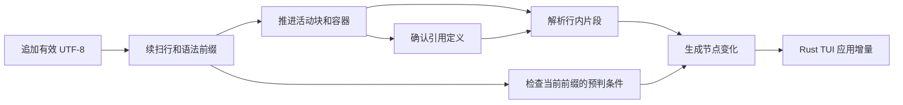

# 面向 Rust TUI 的流式 Markdown 解析架构

## 目标与配置

一个 AI 回复对应一个解析会话。每次追加产生一批带 ID、类型、类型数据和生命周期的更新。TUI 按类型选择组件，按状态决定是否预览、更新或收尾。原生 Rust 提供完整解析和追加解析，共用语法规则。核心只处理 Markdown 数据，换行布局、代码着色和终端转义由 TUI 负责。

语法与预览是两个独立的配置。默认语法采用 GFM，纯 CommonMark 可单独选择。AI 预览显式开启，两种语法都可以搭配 AI 预览。数学、自定义块和 Markstream 特有规则由显式扩展开关控制。语法配置和插件在会话开始前确定。

| 配置 | 决定什么 | TUI 示例 |
| --- | --- | --- |
| `Syntax::Gfm` / `Syntax::CommonMark` | 块与行内语法，决定完整文本的解析结果。 | GFM 支持表格和任务项。 |
| `Preview::Off` / `Preview::Ai` | 前缀证据足够时，是否给 UI 提前发送暂定类型或样式。 | `Syntax::Gfm` + `Preview::Ai` 同时提供 GFM 表格和未完成表格预览。 |

相同语法、扩展和内容在 `finish()` 之后应与完整解析一致，打开或关闭预览均如此。匹配官方示例时使用对应语法及示例指定的扩展。物理围栏是否到齐可以另作生命周期状态记录，完整的语法结构仍按规范生成。 [CommonMark 解析策略](https://spec.commonmark.org/0.31.2/#appendix-a-parsing-strategy) · [GFM 规范](https://github.github.com/gfm/)

## 解析流程



1. **预扫描**从上次游标继续消费新增字节，识别换行、缩进、转义和可能的语法触发符。记录当前行与候选分隔符进度。收到末尾 `\r` 时等待是否与下一段开头的 `\n` 组成 CRLF。网络层拼齐 UTF-8 字符后调用 `append(&str)`。所有位置都以原始输入字节计。
2. **块解析**用活动容器栈按行推进，先检查列表、引用等父块的续行条件，再应用当前语法的块开始、延续和结束规则。区分 lazy continuation、Setext 下划线、GFM 表格分隔行及围栏关闭。确认后的正文区间交给对应叶子块，代码和原始 HTML 等叶子块走各自的正文规则。未完成行只推进当前检查点，后续字节使结论成立时才提交结构。
3. **行内解析**按当前叶子块或表格单元格推进，维护未决的分隔符、反引号长度、括号及引用候选。普通文本追加跨度，局部结论改变时从受影响位置纠正行内结果。块结构变化可重解释其未提交的叶子内容。跨块引用使用单独的依赖索引。
4. **预览投影**读取当前游标的规则状态，经证据门槛产生独立的预览更新。预览在同一块 ID 下发布，并可撤回。源码、语法栈和引用索引只接收真实输入字节。
5. **产生更新**时先创建父节点，再写其子节点或正文。合并同一批次内连续的文本追加。调用方应用变化后可以继续消费下一批。

## 如何预判

预判使用已读取的语法证据。单个触发符只进入规则的候选状态。每条规则定义触发位置、继续等待条件、首次允许展示的条件、确认条件和否决条件。检查转义、容器位置和当前活动块后才发送预览。证据不足时保持现有展示，可在当前尾部继续显示普通文本，或在 AI 模式短暂收住歧义标记。

| 规则 | 等待阶段 | 达到预览门槛 | 确认或撤回 |
| --- | --- | --- | --- |
| GFM 表格 | 只有表头行，或下一行到目前只有管道和空白。 | 完整候选表头后，分隔行已有实际短横线，已读部分仍能补成合法分隔行，列数未超出表头。可以发出表格预览。 | 分隔行结束并匹配列数时确认。遇到不可恢复的字符或列数错误时保留段落。 |
| 列表和引用 | 孤立的 `-`、`>`、`2.`、`1. *`。数字本身可继续作为普通文本。 | 标记、语法要求的边界和该层首个可辨识正文均到齐时再投影容器。 | 正式块规则决定中断段落、缩进和续行；EOF 决定合法的空列表项或空引用。 |
| 围栏代码 | 开头反引号或波浪号数量不足，或 info string 尚不完整。 | 行首位置、缩进、容器条件和完整开围栏行都符合语法时展示代码块；语言从已完成的 info string 读取。 | 确认开围栏即进入 `Open`。只有关闭围栏行确认后才进入 `Closed`。 |
| 强调和行内代码 | 只有 `*`、`**` 或反引号串。 | 已满足分隔符上下文，且有可展示内容时可给同一段落加暂定样式。 | 配对后确认；未配对在段落边界或 EOF 按语法还原。 |
| 链接和图片 | 孤立的 `[`、`![`，或标签还未闭合。 | 标签和目的地起始结构已识别，有合法前缀时可以展示标签预览。 | 语法确认、目的地可用后再提供可交互的链接或图片；补充内容否决时撤回预览。 |
| 数学和自定义块 | 孤立的 `$`、`<`、不完整标签名或不完整扩展前缀。 | 启用对应扩展，达到其专属边界和正文门槛后才投影。货币和比较表达式保留文字。 | 使用扩展自己的结束和回落规则。普通代码、转义及已经确认的语法上下文仍有优先权。 |

例如逐次追加 `A | B\n`、`|`、`-`、`| - |\n`。第一步仍是段落，第二步只是候选扫描状态，第三步可发暂定表格，第四步才确认。若在第三步后接上 `no`，只更新当前块，恢复文本视图。候选检查按新字节推进，前缀越长也无需重复扫描整行。

表格确认后，新行的行首 `|` 已足以识别表格行。此时可以交付空的暂定单元格，正文到达后更新同一行。

以现有 `stream-markdown-parser` 的回归用例给规则取正例和负例。单行表头不应启动表格、孤立列表标记不应引入嵌套项、未闭合粗体最终退回正文，都是现成例子。旧表格预览允许第二行只有管道或后续全角冒号时也保持 loading。新原生 AI 规则要求实际分隔符证据，这些前缀记入迁移差异，并分别保留旧断言和新规则断言。对拍核对可观察行为，差异报告明确到用例及前缀。 [表格回归](../test/original/table-loading-midstate.test.ts) · [有序列表回归](../test/behavior/ordered-list-streaming-jitter.test.ts) · [未闭合粗体回归](../test/behavior/final-unclosed-strong-literal.test.ts)

## 节点、状态和 Rust 接口

首版只在节点上持久化生命周期、原文区间和带类型的数据。`BlockData` 的枚举变体就是节点类型。`BlockId` 是更新流中的地址，在 TUI 的节点表里可直接作为键。创建节点时给出父级和插入位置，树的顺序由消费方保管。同一起点的段落转成 Setext 标题时沿用 ID，分裂出的新块分配新 ID。

```rust
struct Block {
    span: Span,
    status: BlockStatus,
    data: BlockData,
}

enum BlockStatus {
    Open,
    Closed,
    Incomplete,
}
```

| 类型 | 给 UI 的最少数据 |
| --- | --- |
| 段落、标题 | 已确认的行内内容。正文与块区间完全一致时直接引用块区间；标题另有级别。 |
| 代码块 | info string 与代码正文。语言由 info string 派生，`diff`、`mermaid` 等交给专用视图。 |
| 列表、引用 | 子块由树中的位置表达。列表额外记录会影响显示的起始编号、松紧和任务状态。 |
| 表格 | 列对齐、表头和行内单元格，变化按行或当前单元格定位。 |
| HTML 和已注册的自定义标签 | 自定义标签可读取标签名和属性，正文按规则交付。规范模式下的原始 HTML 保留其源码区间。 |
| 数学、脚注、其它扩展节点 | 语法实际需要的类型数据。扩展节点用注册时确定的类型标识和类型化字段。 |

围栏的 info string 通过 `BlockData::code_info()` 读取。摘要和脚注共享所属块的源码起点，通过 `Block::summary_opening()` 和 `Block::footnote_label()` 获取完整区间。

### HTML/XML 风格的自定义标签

已注册的标签规则可产出结构化的块或行内节点，向 TUI 提供 `tag_name()` 和 `attrs()`。标签元数据只存标签名和属性区域的源码区间。属性视图按需迭代键值对，保留原始拼写并区分缺失值与空字符串。读取原值时直接借用源码；需要实体解码时再生成解码后的值。标签正文按规则作为源码或 Markdown 子节点提供。

例如依次收到 `<tool-call name="search" title="a >` 和 ` b">`。预扫描跨 chunk 保留当前引号状态，引号内的 `>` 是属性值的一部分。等引号外的 `>` 到齐，再发出已确认的 `tool-call` 节点及属性。块级配对标签在正文到达期间是 `Open`，收到匹配的结束标签后变为 `Closed`。自闭合写法 `<tool-call name="search" />` 首次交付即为 `Closed`。若开标签已确认但结束标签在 EOF 前缺失，块变为 `Incomplete`。行内标签的暂定样式和更新由所属块管理。

开标签的校验和闭合匹配遵循注册规则选择的语法。规范模式的原始 HTML 可以继续作为原文交付，已注册标签由扩展显式开启。 [XML 起始标签、结束标签和空元素标签](https://www.w3.org/TR/xml/#sec-starttags)

启用 Markstream 后，顶层独立的 `<div>` 或 `<section>` 先按原始 HTML 交付。空行到达且开标签仍未闭合时，解析器复用块 ID，升格为 `HtmlWrapper`。空行前的正文只回读一次并交付为 Markdown 子块，后续正文按行增量解析。

### 三种块状态与暂定预览

| 持久状态 | 需要区分的行为 |
| --- | --- |
| `Open` | 追加仍能改变块。Setext 下划线等正式语法可以改判仍开放的块。 |
| `Closed` | 块的局部语法结构已结束。普通追加跳过该块，晚到引用仍可定点更新内容。 |
| `Incomplete` | 会话已结束，明确需要的闭合标记未到。TUI 停止 loading，仍可区分完整围栏和被截断的围栏。 |

TUI 可见的「暂定」来自独立的预览更新。预览只携带块 ID、覆盖区间和提示的类型或样式；需要新锚点时先建立该位置的普通文本视图，再按该 ID 发布预览。确认或撤回时复用 ID。节点替换、移除或结束时清理覆盖的预览，其它提前撤回的情况发清除操作。仅在内部等待证据的候选保留扫描进度，暂时没有 UI 状态。

| 流式场景 | 需要的最小变化 |
| --- | --- |
| 只收到 `*` 或表格第二行的 `|` | 解析器暂存未决规则状态。UI 维持当前文本或展示收到的普通内容。 |
| `**粗体` 或表格开始满足预判 | 为所属块的源码范围发预览。行内标记由块管理，避免给每个行内片段附加生命周期。 |
| 表格确认或候选被否决 | 正式替换同 ID 的块，或清除预览并保留原有文本。 |
| 围栏正文仍在到达 | 保持 `Open`，发布正文增量。收到合法关闭围栏后发送一次 `Closed` 更新。 |
| EOF 到达且围栏仍未闭合 | 将块更新为 `Incomplete`。EOF 能自然闭合的普通段落更新为 `Closed`。未配对的行内样式按语法还原。 |
| 引用定义在文末到达 | 定点更新已 `Closed` 的块，保留状态和 ID。块移除由更新流表达，传输取消或出错由应用层记录。 |

`finish()` 消费最后一行，再处理未决引用和活动块，结束时所有块都是 `Closed` 或 `Incomplete`，所有预览已清除。重复结束无新增变化，结束后追加返回会话已结束。

Markstream 的 AI 预览用 `InlineKind::CodePreview` 表示已有正文、仍在等待结束反引号的行内代码。补全后交付 `InlineKind::Code`，收尾时仍未匹配的分隔符保留为文字。段落和暂定表格行共用这两种类型，TUI 可以沿用同一套渲染组件和状态样式。

### 源码与增量输出

首版接口形状如下。调用方持有并复用 `out`，解析器向后追加操作。

```rust
fn append(&mut self, chunk: &str, out: &mut Vec<Change>) -> Result<(), ParseError>;
fn finish(&mut self, out: &mut Vec<Change>) -> Result<(), ParseError>;
fn source(&self, span: Span) -> &str;
fn parse<'src>(source: &'src str, options: &Options) -> Result<Document<'src>, ParseError>;
```

`Change` 包含插入、更新、替换、移除和预览。更新按节点类型表达追加代码正文、添加表格行、更新局部行内内容、改变松紧或更新状态。`loading`、`final` 和可交互状态由 TUI 从块状态、是否有预览及可用数据推导。一个块的内容追加和状态更新可以独立发送，正文保持原位。

源码在会话中保留一份。连续文本用半开区间表达，容器缩进和跨行正文可用多个原文片段表达。实体解码等确实产生新内容时才持有新文本。TUI 可以保存节点和区间，按需借用源码；最终消息若要超过会话寿命，可以接管最终源码和节点。解析器把正式节点交给调用方，自己只保留活动规则、待解决依赖和相应位置。已交付的数据无需在解析端留第二棵树。

这里的最小表示指语义字段。实际字节数还取决于最大枚举变体、对齐和子数据分配。首版记录 `Block`、`Change`、源码区间的大小以及每个场景的堆分配，届时再决定是否缩窄偏移、分离大变体或压缩字段。

## 增量状态与块缓存

| 状态 | 从第一版保留的最小信息 | 何时重算 |
| --- | --- | --- |
| 预扫游标与活动块 | 当前行字节位置、容器栈、分隔符进度、最近可确认边界。 | 每次只处理新增内容和确实影响的开放区间。 |
| 结构已确认的块 | 仅在有待解决依赖时索引块 ID 和源码位置。 | 正常追加跳过此前的源码、块和行内解析。已知要回改时才按 ID 定位。 |
| 引用定义与等待者 | 已确认定义，以及规范化标签到受影响叶子块、标题或单元格的索引。 | 首个有效定义确认后，只重算登记的行内范围。 |
| 删除、截断或配置变化 | 由调用方销毁旧会话并重建。 | 追加是首版热路径，编辑型增量独立考虑。 |

引用定义可能跨行，标题补全或后续文本都可能影响它是否成立。先等块规则确认，再通知等待者。晚到定义可能影响括号结合和嵌套关系，回改最小的完整行内上下文，而非仅替换一个链接字段。脚注等影响显示顺序的扩展独立登记依赖。最长未决跨度取决于语法，缓存边界由语法状态确定。

后续通过扫描计数和分配剖析决定是否引入小对象内联、区间压缩、SIMD 扫描或额外热点缓存。第一版的缓存重点是续跑、跳过稳定块和定位真实失效。

## 完整解析

完整解析直接借用已有 `&str`，按批处理入口执行同一套块、行内、插件和结束规则。块解析收集全部定义，随后一次解析各块的行内数据，直接构建最终 `Document`。完整路径可以预分配已知容量，并跳过流式预览、待引用通知和变化记录。与流式结束结果比较时按结构、数据、源码区间和结束状态核对，块 ID 只在各自会话内比较。

## 插件架构

第一版提供内置扩展、Rust 静态注册和运行时加载第三方插件。注册描述包含 ASCII 触发字符、块或行内范围以及结果节点类型。内置规则保留直接调用，第三方规则只接收核心确认可用且命中触发字符的候选。

| 规则阶段 | 插件拿到的输入 | 允许返回 |
| --- | --- | --- |
| 探测 | 从触发字符开始的有界源码片段。 | 拒绝、等待更多输入或接受。 |
| 推进 | 从上次未消费位置开始的有界源码片段。 | 消费进度、等待后续输入或接受。 |
| 结束 | 文档或父容器结束时剩余的输入。 | 接受或把候选交回普通 Markdown。 |

块规则在完整 Markdown 行上按注册顺序探测。行内规则在核心提供的原文文本区间内执行，转义和代码等语法边界由核心判定。块规则等待输入时保留游标和状态，确认接受后由核心分配节点 ID 并输出结构。已消费部分输入的块候选随后拒绝时，核心仅回放该候选的源码，按普通 Markdown 准确恢复块边界。父容器结束时先结束候选，再处理下一行。持续等待且无法在有界窗口内推进会返回插件错误。

运行时插件采用 **WASM 模块 + 有版本的宿主协议**。作为可选宿主层接入，纯 Rust TUI 可以按需选择是否打包运行时。应用注册本地模块及规则描述，宿主在加载时校验协议版本、触发条件和节点字段类型。模块代码可以复用，解析状态按会话隔离。候选命中后通过一次调用传递相关片段或增量，并回收已经结束的规则状态。数据跨边界使用明确的整数、字节区间和类型字段，插件拿不到宿主内存指针。

宿主为第三方插件限制可读区间、指令、线性内存和输出量，只提供解析协议需要的能力。错误的范围、无进展的推进、执行失败和超限作为插件错误返回给调用方。失败时丢弃本次追加产生的变化并终止会话，TUI 可保留此前成功显示的内容。插件通过节点类型和字段与 TUI 对接。ABI v1 交付匹配区间，ABI v2 可附加借用匹配原文的区间、整数和布尔值。 [WASM 宿主与协议](../crates/plugin-host/README.md) · [WebAssembly 核心规范](https://webassembly.github.io/spec/core/intro/introduction.html)

## 验证与实施顺序

1. 先实现 Rust 接口、增量更新和完整解析的最小路径，覆盖段落、Setext、围栏以及晚到引用。为每条预判验证「不足」「可预览」「确认」「否决」「EOF」，同时断言状态转换、预览清理和块 ID。按每个字符边界和固定种子随机切分。相同前缀在不同切法下应产生等价的可见状态，结束后应与静态结构一致。
2. 实现相同插件契约下的一个静态规则与一个运行时规则，并覆盖块、行内候选的优先级和结束行为。验证单个插件追加路径、无匹配规则的调度成本、错误返回及会话隔离。
3. 补齐语法与兼容性。运行官方 CommonMark/GFM 示例、现有候选行为测试和逐前缀差分，从混合测试中继续提取节点层断言。保留旧解析器内部测试，显式记录兼容输出的有意差异。
4. 建立原生基准和 TUI 数据更新基准，再做热点优化。用 Release 构建测静态吞吐、首批有效更新、追加 p95、结束耗时和累计 CPU；单独测应用更新、终端绘制和排队延迟。分配测量独立记录计数、活跃和峰值字节、源码与索引容量、会话释放后保留量；插件另记首次加载、增量调用成本和运行时体积。
5. 在长段落、长围栏、长列表、表格、稳定块和晚到引用上按 1×、2×、4× 检查扩展性。至少记录新增字节、实际扫描字节、稳定块重扫字节、失效块和输出变化数。正常追加要求稳定块重扫为零；晚到引用要求只访问登记的依赖。生态对照以相同输入、切分、语义及输出工作量为前提。 [现有基准脚本](../scripts/benchmark.mjs)
